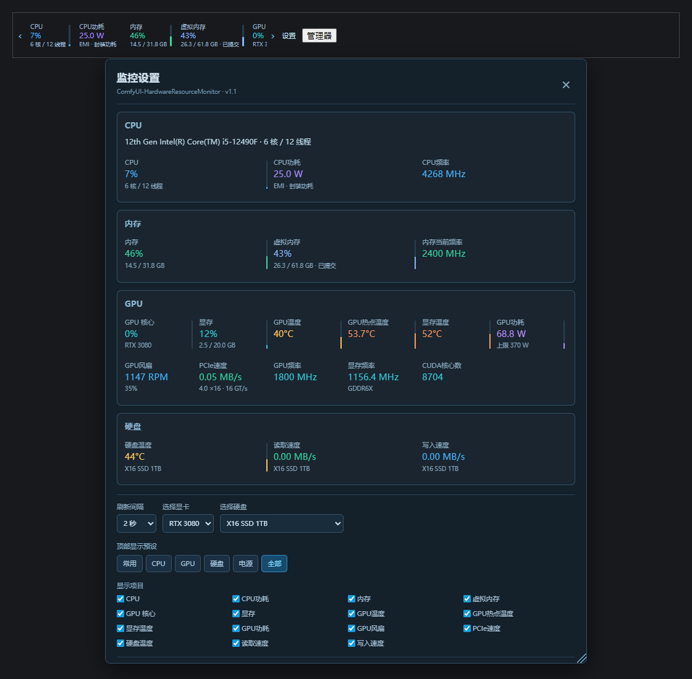

# ComfyUI-HardwareResourceMonitor

**硬件资源监控 · v1.1**

独立开发的 ComfyUI 中文硬件监控插件。透明顶部监控栏固定宽度 460px，支持滚轮、触控板、左右按钮及键盘横向查看，旁边可直接打开监控设置。



## 功能

- CPU 使用率、封装功耗；总览显示型号、核心/线程数及工作频率。
- 内存使用率、容量、当前配置频率；Windows 虚拟内存显示已提交量及提交上限，Linux 单独显示交换空间。
- GPU 核心使用率、型号、显存使用率及容量、GPU/热点/显存温度、功耗与参考上限、风扇 RPM 与百分比、PCIe 速度。
- GPU 及显存频率、NVIDIA CUDA 核心数仅在设置总览展示。GPU 型号随 GPU 开关联动。
- 多显卡及物理硬盘选择，硬盘温度、读取与写入速度。
- CPU、内存、GPU、硬盘分组总览；点击单组打开底部曲线，切换该组动态指标，查看最近 5 分钟历史，悬停显示采样时间与数值。内存配置频率不提供曲线。
- 面板支持标题拖动、内容区长按拖动、右下角缩放、透明度和背景颜色调节；顶部与面板字号独立可选 6–20px。
- 顶部显示项目开关与预设，刷新间隔可选 0.5 / 1 / 2 / 3 秒，设置保存在浏览器。

## 安装与升级

1. 将插件放到 ComfyUI/custom_nodes/ComfyUI-HardwareResourceMonitor，避免同时启用多个副本。
2. 使用运行 ComfyUI 的 Python 安装 requirements.txt 中依赖：

```bash
python -m pip install -r requirements.txt
```

3. 重启 ComfyUI，浏览器 Ctrl+F5 刷新。不要在生成任务进行中重启。
4. 点击顶部“设置”调整显示，反馈问题时可复制诊断信息。

## 支持范围与注意事项

- Windows NVIDIA 使用 NVML 与 LibreHardwareMonitor；AMD / Intel 使用传感器库提供的可用指标。Linux NVIDIA 使用 NVML，其他品牌尝试 DRM / sysfs / hwmon。跨品牌覆盖依赖硬件和驱动，并不保证所有指标可读。
- 已在 Windows、i5-12490F、RTX 3080 与本机 SSD 验证；AMD、Intel GPU 和 Linux 尚未完成实机验证。
- 仅使用普通用户可访问的接口，不请求提权、不安装服务或驱动，不要求运行其他监控软件。未提供的读数显示“未支持”，不估算或伪造。
- Windows CPU 功耗使用系统 EMI 的 CPU package 能量差分，需系统公开对应通道；首次采样可能显示“采样中”。
- PCIe 速度仍只采集传入 GPU 的 RX 吞吐，名称简化不会改变方向；NVIDIA 数据为驱动短窗口快照，不是整个刷新间隔的平均速度。其他接口未提供吞吐时显示未支持。
- 基础速度以字节/10⁶显示 MB/s，达到 1024 MB/s 后除以 1024 显示 GB/s。容量按 1024³换算并沿用 GB 标签。
- 内存当前频率来自系统配置字段，不读取或推测 XMP 最高频率。显存类型已确认时转换驱动时钟口径，无法确认时标为“显存驱动频率”。
- GPU 功耗上限、温度竖条及曲线 90°C 参考线仅作读数或视觉参考，不修改硬件配置，不将实际功耗限制在参考上限以内。
- 前端按所选间隔请求；后端普通读数最小缓存 0.5 秒，慢速传感器按 5 秒采集，多页面共用缓存。页面隐藏暂停请求，Windows 辅助采集进程无请求后约 12–17 秒退出。
- 历史仅保存在当前页面内存，按 1 秒桶合并，每设备最多 305 点；无历史写盘，无后台曲线动画。
- 本机分离测试估算：2 秒刷新、仅顶部显示时，前后端新增工作集约 124 MiB，平均整机 CPU 约 0.11%。这是特定机器的短时测试，前端使用隔离浏览器模拟数据，不代表全部 ComfyUI 占用或其他机器结果。

## 与其他资源监控插件的冲突

建议只启用一个资源监控插件。与 ComfyUI-Crystools 或其他同类插件同时使用，可能重复显示监控栏、挤占工具栏，受主题样式或插入位置影响出现遮挡，也可能重复采集并增加开销。并非必然冲突；遇到问题先停用其他监控插件，再重启并强制刷新。本插件不会自动禁用其他插件。

## 隐私与反馈

无遥测、广告、自动更新或外部网络请求。前端只访问当前 ComfyUI 的 /hardware-resource-monitor/stats；诊断信息由用户主动复制。反馈时附操作系统、GPU/驱动、ComfyUI 版本、诊断 JSON、主题和同类插件情况。

## 引用仓库与第三方依赖

| 项目 / 仓库 | 使用方式与用途 |
| --- | --- |
| [LibreHardwareMonitor/LibreHardwareMonitor](https://github.com/LibreHardwareMonitor/LibreHardwareMonitor) | 使用官方 v0.9.6 发布包中的 Windows 传感器库，读取 NVIDIA、AMD、Intel 显卡信息；没有修改其源代码 |
| [giampaolo/psutil](https://github.com/giampaolo/psutil) | Python 依赖，用于 CPU 使用率和系统内存读数 |
| [aio-libs/aiohttp](https://github.com/aio-libs/aiohttp) | 复用 ComfyUI 自带依赖，提供本地 JSON 监控接口 |
| [Comfy-Org/ComfyUI](https://github.com/Comfy-Org/ComfyUI) | 集成其扩展注册、前端 API 和服务器路由接口；不是复制 ComfyUI 源码 |

另使用 NVIDIA 官方 [nvidia-ml-py](https://pypi.org/project/nvidia-ml-py/) Python NVML 绑定。其已安装包元数据没有声明对应 GitHub 源码仓库，因此不将同名或第三方 pynvml 仓库误标为来源。NVML 运行库由 NVIDIA 驱动提供。

随 LibreHardwareMonitor 官方发行包附带的其他 DLL 及许可证，以 `lib/windows/THIRD-PARTY-NOTICES.txt` 和上游 v0.9.6 发行源码为准。插件原创前后端代码与这些依赖分别遵循各自许可。

## 开源许可与第三方库

本插件原创代码使用 MIT 许可，见 LICENSE。

`lib/windows` 的第三方二进制不适用本插件 MIT 许可：LibreHardwareMonitor 使用 MPL-2.0，其他组件各自遵循原许可。随包附带对应 LICENSE 和 THIRD-PARTY-NOTICES.txt。

- 库来源：https://github.com/LibreHardwareMonitor/LibreHardwareMonitor/releases/tag/v0.9.6
- 对应源码：https://github.com/LibreHardwareMonitor/LibreHardwareMonitor/tree/v0.9.6


## 额外接口参考（未复制源码）

- [微软 win32metadata](https://github.com/microsoft/win32metadata)：EMI 接口定义；CPU 功耗采集封装独立实现。
- [PwrMon](https://github.com/brettkcherry/PwrMon)、[Intel PCM](https://github.com/intel/pcm)、[PawnIO](https://github.com/namazso/PawnIO)：查阅采集方案和权限边界，不打包或调用这些项目。
- [NVIDIA NVAPI](https://github.com/NVIDIA/nvapi)、[NvAPIWrapper](https://github.com/falahati/NvAPIWrapper)：参考只读显存类型接口约定，Python 封装独立实现，没有引入 NvAPIWrapper 库。
- [Core Temp 原理说明](https://www.alcpu.com/CoreTemp/howitworks.html)：仅研究 CPU DTS/MSR 读取原理；本版不依赖其程序、共享内存、SDK 或驱动。

Windows 采集桥原创源码为 sensors/HardwareSensors.cs；实际运行的第三方依赖及许可见上表与 lib/windows 下的声明。
